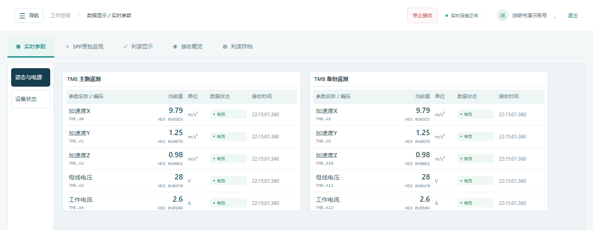
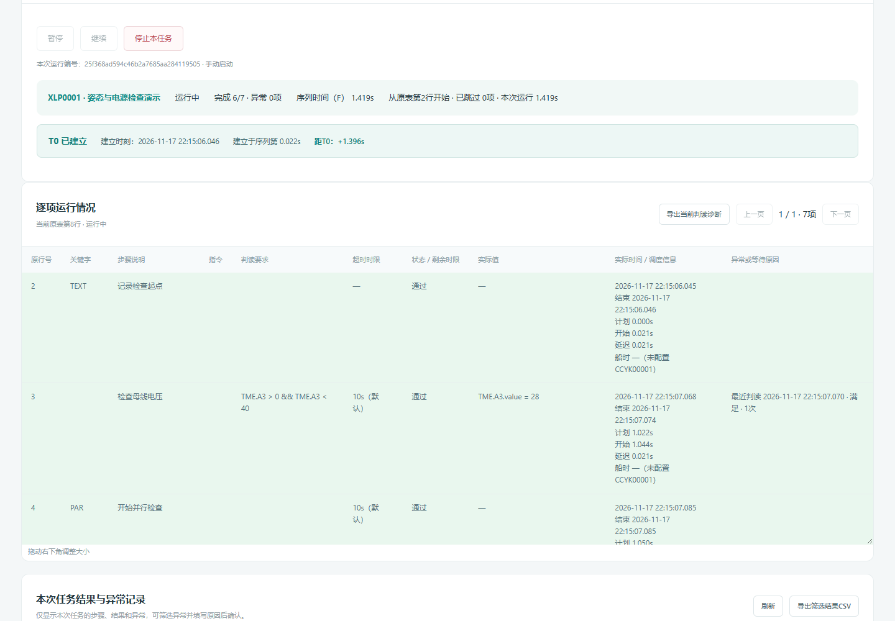

# DMS 数据判读系统

面向分系统测试与半实物仿真的离线数据接收、遥测解码、自动判读和序列任务系统。

**当前版本：V0.10.34** · Windows 10 · 浏览器内网访问 · 无需数据库

[下载最新版本](https://github.com/gvidado/DMS/releases/latest) · [版本记录](CHANGELOG.md) · [使用说明书](https://github.com/gvidado/DMS/releases/download/v0.10.34/DMS-v0.10.26-user-manual.docx) · [问题反馈](https://github.com/gvidado/DMS/issues)

## 系统解决什么问题

- 遥测基线更新时，通过 Excel 读取解码表、SPP 和判读规则，减少重复录入和配置核对。
- 对常规参数持续并行判读，让测试人员集中处理异常、关键步骤与试验决策。
- 将测试工作程序转换为可运行的串行和并行序列，支持定时、暂停、跳转与独立任务。
- 将接收、解码、发令、判读和异常处理集中在同一系统中，保留可复查的运行结果。

## 功能总览

| 主功能 | 已有能力 |
| --- | --- |
| 数据显示 | 多画面实时参数、独立SPP原包监视、判读显示、接收统计、发送监视、判读存档 |
| 系统配置 | UDP与组播、遥测Excel导入、SPP配置、参数映射、常态化规则、共享变量、TC绑定 |
| 本地检验 | PCAPNG文件检验、异常原包导出、1至5倍速演示、本机真实UDP回放 |
| 指令控制 | BC/PSS/KC/YKE/YKM/ZK指令库、Excel/BIN/XML/CSV导入、发送预览、UDP发送、自由布局指令面板 |
| 序列任务 | Excel导入与转换、逐行修正、序列执行与判读、多任务独立运行、超时诊断、结果导出 |
| 账号管理 | 管理员与用户、个人参数画面及指令面板配置 |

### 遥测解码与原包监视

从UDP到达事件接收数据，支持组播和来源筛选。遥测表从第二个Sheet开始读取，预留参数跳过，按系数换算工程值，支持位域解析和注释项。SPP可手工配置或按Sheet批量导入，按外层数据源、包标识、源地址、业务类型和子类型匹配，采用Fletcher-16校验。

参数按来源区分为 `TME.A1`、`TMB.A1` 等引用。原包监视可独立于解码启用，每个SPP暂存最近200条，可查看完整源码并导出CSV。

### 可配置显示画面

每个画面可放置多个独立参数框，调整位置、尺寸、字号、固定行高、列数、列宽及显示字段。支持按TME/TMB、SPP和解码表选择参数，跨画面复制粘贴、多选对齐及等距分布。单框参数数量没有固定上限，实际容量受浏览器资源约束。



### 常态化判读

规则采用初始化域、状态域和结果域，支持工程值、最近有效历史值、范围、IF分支、数学函数、注释项集合、TC指令事件、时间条件和连续帧条件。监听和判读分别控制，参数可设一般、重要、关键等级及独立启用状态。

```text
ResultRegion
    if abs(this.value-9.8)<1 then
        RET=Normal;
    else
        RET=Error;
    end
EndResultRegion
```

### 序列执行与序列判读

- **序列执行**主动发送指令；**序列判读**监视指令并检查参数。
- 标准七列Excel配置，也可将十一列表转换成七列表，并匹配库内指令代号。
- 支持空关键字串行、`TEXT`、`PAR/CHANGE`并行、`HOLD`持续检查、`PLUSE`人工暂停和`CALL`。
- 支持相对时间、`T0:n`、`F:n`、从指定行开始、T0/F0预置及超时诊断。
- 每次启动形成独立任务和网页内运行标签，允许多个任务并行运行。
- 序列条件可写 `abs(TME.A1-9.8)<1`，支持与、或、非及数学函数。



图中为隔离环境的演示数据，不代表真实试验记录。

### 指令与异常处理

指令支持完整UDP及数据内容区预览、可编辑编号名称、多目的地址、固定源/目的端口及可排布按钮面板。当前EB90封装仅功能ID `0x00AA` 使用两字节接口类型，其余使用四字节，均为小端。

常态化、序列和SPP接收异常集中查看，支持单条或批量填写原因后解除，并保留记录。常态化结果按天总结，序列结果按次存档，支持检索及CSV导出。

## 下载和启动

在 [Releases](https://github.com/gvidado/DMS/releases/latest) 中选择：

| 文件 | 用途 |
| --- | --- |
| `DMS-v0.10.34-windows-offline.zip` | 新部署，内含空配置和默认监听设置 |
| `DMS-v0.10.34-windows-upgrade.zip` | 更新现有部署，保留现场config、data和logs |
| `DMS-v0.10.26-user-manual.docx` | 完整使用说明，适用V0.10.26；后续变化见对应版本说明 |
| `SHA256SUMS.txt` | 发布附件的SHA-256校验值 |

1. 在Windows10解压完整离线包，运行“本机预览.cmd”或“启动服务器.cmd”。
2. 本机访问 `http://localhost:8080`，首次在本机网页创建管理员账号。
3. 内网用户访问 `http://服务器IP:8080`。按实际网络配置防火墙、监听网卡、端口及组播。
4. 导入解码表和SPP、核对映射与系数，配置参数画面，再开始监听和判读。

干净包默认组播 `224.10.2.24`、UDP目的端口 `30008`、来源白名单 `192.168.1.111` 至 `.113`。遥测、SPP、规则、指令库和序列均为空，无预置账号和试验数据。

程序使用.NET Framework 4.x。发送抓包监视等功能需要在目标机器安装Npcap；它不随本仓库重新分发。只运行已发布的软件不需要安装Node.js、Python、Excel或数据库。

升级前停止旧程序，将升级包覆盖到原目录，保留 `config`、`data` 和 `logs`，重新启动并按 `Ctrl+F5` 刷新网页。

## 从源码构建

```powershell
git clone https://github.com/gvidado/DMS.git
Set-Location DMS
powershell.exe -NoProfile -ExecutionPolicy Bypass -File .\build.ps1
```

构建使用Windows自带.NET Framework C#编译器，并执行协议自检。若需要在源码目录运行，可将 `config.example` 复制为 `config`，再运行启动脚本。不要将现场配置或运行数据提交到仓库。

```powershell
Copy-Item -LiteralPath .\config.example -Destination .\config -Recurse
.\本机预览.cmd
```

## 目录结构

```text
src/             服务端C#源码
web/             浏览器界面
tools/           构建、打包、检验及发布工具
config.example/  从程序类型生成的空配置示例
说明/             当前版本与功能说明
docs/            使用说明书和演示截图
.github/         持续构建检查
```

## 当前边界

- 软件本体完全离线运行；GitHub用于源码维护和版本分发。
- V0.10.22起移除了PostgreSQL及全量遥测历史数据库功能，保留文件判读存档和运行所需短期缓存。
- 本版为基于明确规则的判读系统。服务端保留DSH兼容接口；独立开发中的DSH/Agent插件不混入本次本体源码快照和正式安装包，待单独验证后再发布。
- 原包及最近发送等暂存数据有数量和生命周期限制，不能代替永久全量抓包。
- 模型推理不参与UDP实时接收和确定性判读时序。

## 版本维护

版本号以 `src/AssemblyInfo.cs` 为准。每次正式发版同步源码、项目说明、更新记录、版本标签、离线包、升级包及校验值。具体流程见 [版本发布约定](RELEASING.md)。原有 `DMS-NO-AI` 标签及其预发布保留。

仓库尚未指定开源许可证。
